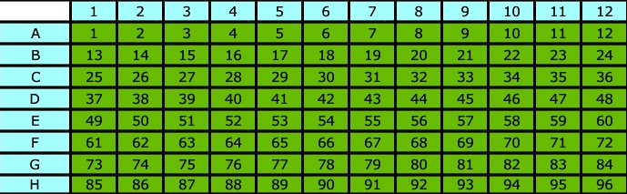
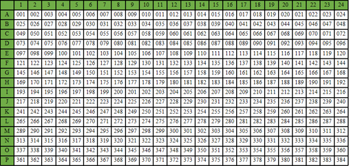

## Usage

### 1. Prepare the RNA genome directory

Refer to the [RNA assay guide](multi_rna.md) for details.

---

### 2. Generate scripts for each sample

In your working directory, create a shell script named `run.sh`:

```bash
multi_bulk_dynaseq \
  --mapfile ./mapfile \
  --genomeDir {path to genome directory} \
  --well_sample well_sample.tsv \
  --thread 16 \
  --mod shell
```

For control wells, use `--control_well` to specify control well numbers (comma-separated). Control wells are used as background SNP sources and are excluded from the replacement step.

```bash
multi_bulk_dynaseq \
  --mapfile ./rna.mapfile \
  --genomeDir {path to genome directory} \
  --well_sample well_sample.tsv \
  --control_well 1,2 \
  --thread 16 \
  --mod shell
```

Optional: add `--bg` to provide external background SNP files (CSV or VCF format).

#### Arguments

`--mapfile`
Required. The mapfile is a tab-delimited text file containing at least three columns. Each line represents one pair of FASTQ files.

* 1st column: FASTQ file prefix
* 2nd column: FASTQ file directory path
* 3rd column: Sample name, which is the prefix of all output files

Example:

```bash
$ cat ./my.mapfile
fastq_prefix1	fastq_dir1	sample1

$ ls fastq_dir1
fastq_prefix1_R1.fq.gz	fastq_prefix1_R2.fq.gz
```

`--genomeDir`
Required. The path to the genome directory generated by `celescope rna mkref`.

`--well_sample`
Required. A TSV file containing well numbers and sample names of wells.

* 1st column: Well numbers
* 2nd column: Corresponding sample names

**96 well number (8 × 12)**



**384 well number (16 × 24)**, used in `bulk_rna-V1` and `bulk_rna-V3-384`



Example:

```tsv
1	control1
2	control2
3	treatment1
4	treatment2
...
```

`--chemistry`
Chemistry version. Available choices:

| Chemistry | Pattern | Description |
|-----------|---------|-------------|
| `bulk_rna-V1` | C9U12 | 384-well format |
| `bulk_rna-V2` | L9C9U12 | |
| `bulk_rna-V3` | C6U16 | |
| `bulk_rna-V3-384` | C6U16 | 384-well format |
| `bulk_rna-bulk_vdj_match` | L18C6U16 | Matched with bulk_vdj |

Default is `auto`, which automatically detects the chemistry from the FASTQ files. Please note that `bulk_rna-V3-384` can **not** be auto detected and you need to specify `--chemistry bulk_rna-V3-384` explicitly.

`--control_well`
Optional. Control well numbers, comma-separated (e.g., `1,2`). Control wells provide background SNP information for the replacement step and are excluded from labeled/unlabeled quantification.

`--bg`
Optional. External background SNP file(s) in CSV or VCF format. Can specify multiple files. These are used as additional background SNPs in the replacement step.

After running:

```bash
sh run.sh
```

a `shell` directory containing `{sample}.sh` files will be generated.

Start the analysis by running:

```bash
bash ./shell/{sample}.sh
```

Please note that `./shell/{sample}.sh` must be executed from the working directory. It should not be run from inside the `shell` directory.

---

## Main Output

- `outs/{sample}_labeled_matrix.tsv.gz`
  Labeled (new) RNA UMI count matrix. Rows are genes, columns are wells.

- `outs/{sample}_unlabeled_matrix.tsv.gz`
  Unlabeled (old) RNA UMI count matrix. Rows are genes, columns are wells.

  **Structure:**
  * **Rows**: Gene IDs (e.g., `ENSG00000223972`)
  * **Columns**: Sample names as defined in the `--well_sample` file (e.g., `control1`, `treatment1`)
  * **Values**: UMI counts

---

## Features

### starsolo

Performs read alignment and UMI counting with STARsolo. Identical to `bulk_rna` starsolo, with the addition of the `MD` SAM attribute (required for conversion analysis). Well metrics are also exported as a CSV file.

### split

Splits the BAM file by well barcodes. 

### conversion

Identifies T-to-C conversion sites in each well's BAM file independently. Runs in parallel across wells using multiprocessing.

**Per-well output** (in `03.conversion/{well}/`):

- `{well}.PosTag.bam` BAM file with conversion position tags.
- `{well}.PosTag.csv` T-to-C conversion sites info.
- `{well}.snp.csv` Candidate SNP sites (used as per-well background in replacement).

### substitution

Calculates the overall nucleotide substitution rates per well. 

**Output:**

- `04.substitution/{sample}.substitution.csv` Combined substitution rate table (rows = wells, columns = 12 substitution types).

**Report:**

- Heatmap of substitution rates (well × substitution type).
- Bar plot of substitution rate ratios per well.

### replacement

Quantifies labeled (new) and unlabeled (old) RNA per well, then merges all wells into a single output. Each well's `PosTag.bam` is processed independently with its own per-well SNP background (plus optional external background and control-well SNPs).

**Output:**

- `05.replacement/{sample}_labeled_matrix.tsv.gz` Merged labeled RNA count matrix (gene × well).
- `05.replacement/{sample}_unlabeled_matrix.tsv.gz` Merged unlabeled RNA count matrix (gene × well).

**Report:**

- Box plot of labeled UMI rate and gene rate across wells.
- Detailed table per well.

---

## Step-specific Arguments

`--basequalilty`
Min base quality of the read sequence. Default: 20.

`--snp_threshold`
SNP threshold filter. Sites with a conversion ratio ≥ this threshold are recognized as SNPs. Default: 0.5.

`--snp_min_depth`
Minimum depth to call a SNP. Default: 20.

`--conversionMem`
Memory (GB) for the conversion step. Default: 5.

`--replacementMem`
Memory (GB) for the replacement step. Default: 10.
