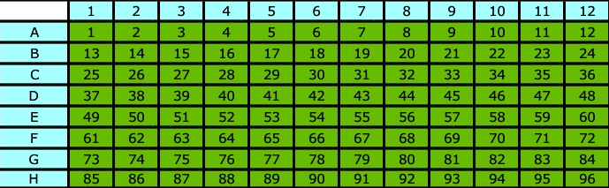
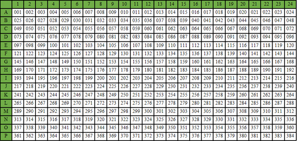

## Introduction

The pipeline is designed for the bulk RNA library construction products offered by Singleron, i.e. [AccuraCode® RNA library construction](https://singleron.bio/products/accuracode-rna-library-construction/). During data analysis, the CeleScope `multi_bulk_rna` pipeline extracts well barcodes and UMIs from R1 reads, aligns R2 reads to the genome with [STARsolo](https://github.com/alexdobin/STAR), collapses reads to UMI counts per well, and rewrites the well barcodes as the user-supplied sample names. The result is a single gene × sample UMI-count matrix covering every well on the plate. Optionally, the pipeline can also split the FASTQ and BAM files well by well.

Because every well is processed identically and only the well barcode distinguishes the samples, the number of samples is limited only by the plate format: up to **96 samples** with a 96-well plate (8 × 12) and up to **384 samples** with a 384-well plate (16 × 24). All samples share one library construction and one sequencing run, which reduces per-sample cost and batch effects between samples.

The pipeline provides three steps (`sample`, `starsolo`, `split`), writes a TSV matrix keyed by sample name, and optionally splits per-well FASTQ and BAM files.

---

## Usage

### Prerequisites

Before running `multi_bulk_rna`, you need a genome directory created by `celescope rna mkref`, and a well-to-sample mapping file (`--well_sample`) describing which sample occupies which well.

---

### 1. Prepare the genome directory

Refer to the [RNA assay guide](multi_rna.md) for the full `mkref` commands for human (`hs_ensembl_110`) and mouse (`mmu_ensembl_110`).

---

### 2. Generate scripts for each sample

In your working directory, create a shell script named `run.sh`:

```bash
multi_bulk_rna \
  --mapfile ./rna.mapfile \
  --genomeDir {path to hs_ensembl_110 or mmu_ensembl_110} \
  --well_sample ./well_sample.tsv \
  --thread 16 \
  --mod shell
```

To also split the FASTQ and/or BAM files per well, add `--split_fastq` and `--split_bam`:

```bash
multi_bulk_rna \
  --mapfile ./rna.mapfile \
  --genomeDir {path to hs_ensembl_110 or mmu_ensembl_110} \
  --well_sample ./well_sample.tsv \
  --thread 16 \
  --split_fastq \
  --split_bam \
  --mod shell
```

#### Arguments

`--mapfile`
Required. The mapfile is a tab-delimited text file containing at least 3 columns. Each line represents one pair of FASTQ files.

* 1st column: FASTQ file prefix
* 2nd column: FASTQ file directory
* 3rd column: Sample name, which will be used as the prefix for all output files

Example:

```bash
$ cat ./rna.mapfile
fastq_prefix1	fastq_dir1	sample1

$ ls fastq_dir1
fastq_prefix1_1.fq.gz	fastq_prefix1_2.fq.gz
```

`--genomeDir`
Required. The path to the genome directory generated by `celescope rna mkref`.

`--well_sample`
Required. A TSV file mapping well numbers to sample names. Each line has two columns:

* 1st column: Well number, identical to the order of the well barcode whitelist (`bc.txt`) shipped with the chemistry
* 2nd column: Sample name used in the output matrix

**96-well numbering (8 × 12)**



**384-well numbering (16 × 24)**, used by `bulk_rna-V1` and `bulk_rna-V3-384`



Example:

```tsv
1	control1
2	control2
3	treatment1
4	treatment2
...
```

Only wells listed in this file are kept in the output matrix, and their barcodes are replaced by the sample names in the 2nd column. Wells that have reads but are not listed are discarded; wells that are listed but have no reads still appear as all-zero columns.

`--chemistry`
Default: `auto`. Chemistry version. Available choices:

| Chemistry | Pattern | Description |
|---|---|---|
| `bulk_rna-V1` | C9U12 | 384-well format |
| `bulk_rna-V2` | L9C9U12 | |
| `bulk_rna-V3` | C6U16 | |
| `bulk_rna-V3-384` | C6U16 | 384-well format |
| `bulk_rna-bulk_vdj_match` | L18C6U16 | Matched with `bulk_vdj` |

`auto` detects the chemistry from the first 10,000 R1 reads, trying `bulk_rna-bulk_vdj_match`, `bulk_rna-V2`, `bulk_rna-V1` and `bulk_rna-V3` in that order. Note that `bulk_rna-V3-384` can **not** be auto-detected, because it shares the same R1 pattern (`C6U16`) as `bulk_rna-V3`; you must specify `--chemistry bulk_rna-V3-384` explicitly.

`--thread`
Default: `16`. The recommended number of threads is 16. Using more than 20 threads is generally not recommended, because [the mapping speed of STAR tends to saturate above approximately 20 threads](https://github.com/singleron-RD/CeleScope/issues/197).

`--mod`
Default: `sjm`. Specifies the script type to generate. Available options include `sjm`, which uses [Simple Job Manager](https://github.com/StanfordBioinformatics/SJM), and `shell`, which generates standard shell scripts.

After running:

```bash
sh run.sh
```

a `shell` directory containing `{sample}.sh` files will be generated.

Start the analysis by running:

```bash
bash ./shell/{sample}.sh
```

Please note that `./shell/{sample}.sh` must be executed from the working directory. It should not be run from inside the `shell` directory.

---

## Pipeline Steps

`sample` is a shared CeleScope step that runs ahead of `starsolo`. It detects the chemistry, writes the report header and produces a debug bundle; it is documented in [common_sample.md](./common_sample.md). 


### Step 1. starsolo

`starsolo` is a shared CeleScope step. It aligns R2 reads to the genome, extracts well barcodes and UMIs from R1, and collapses reads into a UMI-count matrix. In `bulk_rna` the "barcode" is a **well** rather than a cell.

For the full description of the process, arguments, output and HTML metrics, see [common_starsolo.md](./common_starsolo.md).

#### Differences from the shared `starsolo` step

1. **The barcode identifies a well, not a cell.**
   `bulk_rna` has one sample per well, up to 96 wells on a 96-well plate or 384 wells on a 384-well plate, and every well in the whitelist is a real sample. That is why the "cell" metrics of the shared step become "well" metrics here: `Number of Wells`, `Fraction of Reads in Wells`, `Mean Used Reads per Well`, `Median UMI per Well` and `Median Genes per Well`, with the same definitions otherwise.

2. **No cell calling.**
   Cell calling exists to separate real cells from empty droplets; there are no empty wells to filter out, so the filtered matrix is simply "all wells with at least one UMI". The `cells` step is therefore removed from the driver as well, so cell calling is never re-run.

3. **Every well is renamed to a sample name.**
   The barcodes are replaced by the sample names given in `--well_sample`, and wells that are not listed there are discarded. Without this, the matrix would be keyed by barcode and the reader would have to translate well numbers by hand.

4. **An extra gene × sample matrix is produced.**
   `{sample}_matrix.tsv.gz` is written from the filtered matrix after the renaming. Downstream analysis of `bulk_rna` works directly on sample columns, so a TSV keyed by sample name is more convenient than 10x-format files keyed by barcode.

5. **Unmapped reads are kept in the BAM.**
   Unmapped reads normally do not need to be retained, but `split` recovers the raw reads from the BAM, so they are kept to keep the per-well FASTQ output complete.

6. **A reverse strand setting is added for `bulk_rna-bulk_vdj_match`.**
   That library is reverse-stranded relative to the default, so the strand setting is overridden automatically; otherwise the counted strand would be wrong.

7. **A per-well summary table is written.**
   It gives one line per well with its sample name, barcode, read counts, saturation, UMI and gene counts, so each sample's library quality can be checked individually instead of only in aggregate.

8. **`--create_loom` has no effect.**
   The loom file is intended for single-cell velocity analysis, which does not apply to one-sample-per-well data, so no `.loom` file is produced even if the argument is given.


#### Output

In addition to everything listed in [common_starsolo.md](./common_starsolo.md):

`{outdir}/{sample}_matrix.tsv.gz`
Gene × sample UMI count matrix in TSV format, gzip-compressed. Derived from the filtered matrix by keeping only wells present in `--well_sample` and renaming them to sample names. See [Main output](#main-output) for its structure.

`{outdir}/{sample}_Solo.out/{report_soloFeature}/filtered/`
Restricted to wells that have at least one UMI. This is the matrix from which `{sample}_matrix.tsv.gz` is derived.

`{outdir}/{sample}_Aligned.sortedByCoord.out.bam`
Unmapped reads are retained. This file is the input of the `split` step.

#### Metrics (added to HTML report)

The alignment, demultiplexing and barcode rank metrics are identical to the shared page ([common_starsolo.md](./common_starsolo.md)). Only the second group differs, because the unit of the experiment is a well instead of a cell:

| Metric Name | Description | Why it differs |
|---|---|---|
| Number of Wells | Number of wells with at least one UMI | There is no cell calling, so every retained well is a sample rather than a called cell |
| Fraction of Reads in Wells | Reads assigned to those wells over all counted reads | Same quantity as `Fraction Reads in Cells`, keyed by well |
| Mean Used Reads per Well | Mean number of uniquely-mapped-to-transcriptome reads per well | Gives the per-sample sequencing depth instead of the per-cell depth |
| Median UMI per Well | Median UMI count per well | Gives the typical per-sample library complexity |
| Median Genes per Well | Median number of detected genes per well | Gives the typical per-sample gene detection |

A per-well table *Metrics for a Single Well* is also written, one line per retained well, with its sample name, barcode, read counts, saturation, UMI and gene counts, so each sample can be checked individually rather than only in the aggregate.

---

### Step 2. split（Optional）

Split the BAM and FASTQ by well barcode into one file per sample.

#### Process

Read the same chemistry, R1 pattern and well barcode whitelist used by `starsolo`, then map well numbers to sample names through `--well_sample`. The input BAM is scanned once: reads without a well barcode, or whose barcode is not listed in `--well_sample`, are skipped; all other reads are written to the BAM of their sample (with `--split_bam`) and to the FASTQ of their sample (with `--split_fastq`).

For the FASTQ output:

* Only R2 (the RNA read) is written; R1 is omitted because it contains the barcode and UMI.
* The sequence is always written in the forward orientation, reverse-complemented when the read aligned to the reverse strand, so the output can be fed directly into another aligner.
* The UMI is appended to the read name separated by `:`, i.e. `{read_name}:{umi}`, so that UMI information is not lost when R1 is dropped.
* Reads that map to multiple loci are written only once per read name, so a read is not duplicated across wells.
* Output is written to `{outdir}/{sample}.fq.gz`.

For the BAM output, the input header is copied and unmapped reads are kept as they are in the input; the output is `{outdir}/{sample}.bam`, in the input order.

If neither `--split_fastq` nor `--split_bam` is set, the step reports that nothing is to be split and exits without doing any work.

#### Arguments

`--split_fastq`
If set, write one gzipped FASTQ per sample (`{sample}.fq.gz`) with UMI appended to the read name.

`--split_bam`
If set, write one BAM per sample (`{sample}.bam`).

To split the **raw** R1 and R2 FASTQ files instead of the reads in the BAM, use [split_bulk_fastq](../split_bulk_fastq.md).

#### Output

`{outdir}/{sample}.fq.gz` (when `--split_fastq`)
One gzipped FASTQ per sample, containing the forward-strand R2 reads assigned to that sample with UMI appended to the read name as `{read_name}:{umi}`.

`{outdir}/{sample}.bam` (when `--split_bam`)
One BAM per sample, containing the reads assigned to that sample, with the header copied from the input BAM.

---

## Main output

`outs/{sample}_matrix.tsv.gz`
The gene × sample UMI count matrix, in TSV format, gzip-compressed. This is the main result of the assay.

**Structure:**

* **Rows**: Gene IDs (e.g., `ENSG00000223972`)
* **Columns**: Sample names as defined in the `--well_sample` file (e.g., `control1`, `treatment1`)
* **Values**: UMI (Unique Molecular Identifier) counts — the number of unique transcript molecules detected for each gene in each sample

**Example:**

```tsv
	control1	control2	treatment1	treatment2
ENSG00000223972	12	8	15	10
ENSG00000227232	0	5	3	7
ENSG00000278267	45	38	52	41
```

**Notes:**

* The matrix is generated by collapsing raw reads to UMI counts, which removes PCR duplicates.
* Only wells (barcodes) present in the `--well_sample` file are included; barcodes are converted to sample names.
* No cell calling is performed, so a well is kept as soon as it has a single UMI. Wells listed in `--well_sample` but absent from the filtered matrix still appear as all-zero columns, which keeps the column order aligned with the sample sheet.

`outs/{sample}_report.html`
Integrated HTML report for the whole pipeline.